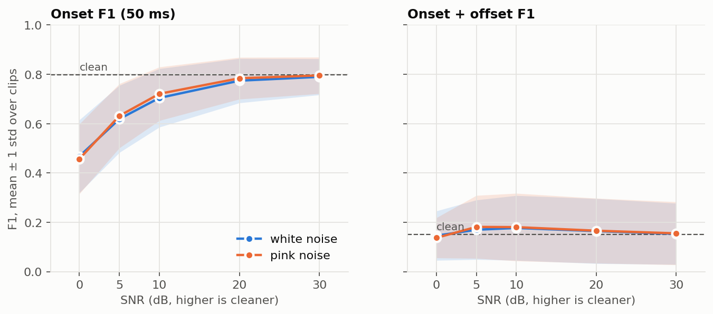
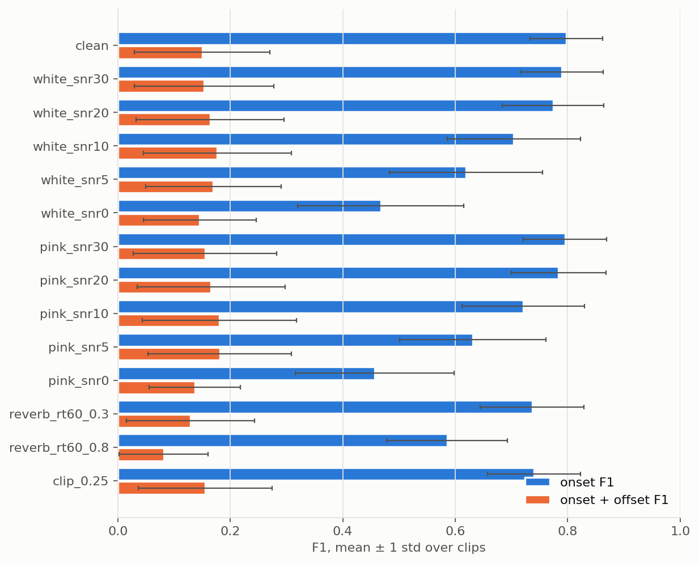
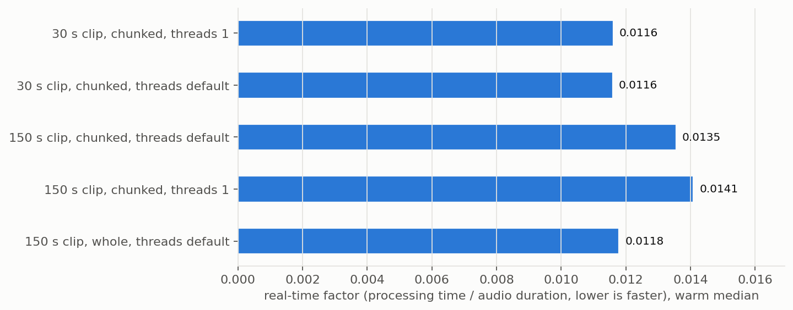

# Melodia evaluation

Numbers below are generated from `eval/results/20261123T113726Z_847903c.json` by `python -m eval.report`. Nothing in this file is typed by hand.


## Summary

- Transcription accuracy on 20 synthesized MAESTRO excerpts of 30 s: onset F1 **0.798 ± 0.065**, onset+offset F1 **0.150 ± 0.121** (mean ± std over clips).
- Weakest condition by onset F1 is `pink_snr0` at 0.457, a change of -0.341 against clean.
- Chunked transcription (30 s windows, 4 s overlap, boundary welding) versus whole-file on 3 long excerpts: onset F1 change +0.0014, onset+offset F1 change -0.0023; the two outputs agree with each other at onset F1 0.967.
- Boundary weld epsilon sweep: no value changed any note or any score on these excerpts (see the limits of that statement below).
- Speed: real-time factor 0.0116 for a 30 s clip (warm, default threads), on Apple M1 Pro.

## Setup

**Data.** MAESTRO v3.0.0 MIDI-only archive (SHA-256 `70470ee253295c8d...`), `test` split. 20 excerpts of 30 s from distinct pieces, chosen with a fixed seed (42) and a minimum note density; plus 3 excerpts of 150 s from other pieces for the streaming comparison. The selection is committed as `eval/manifest.json` and is reproduced byte for byte by the code (tested).

**Audio.** Each excerpt MIDI is rendered with the FluidSynth CLI (FluidSynth runtime version 2.6.3) and `GeneralUser-GS.sf2` to 16000 Hz mono, FluidSynth reverb and chorus off. Sustain pedal is stripped from the excerpt MIDI, so note-off times in the ground truth match the audio. The ground truth is read back from the exact MIDI file that was rendered.

**System under test.** The production code path in `backend/app/inference.py`, imported and not copied: `_transcribe_full_chunked` for the chunked path (chunk 30 s, overlap 4 s, `_merge_chunk_notes` welding) and `_run_basic_pitch_predict` for the whole-file path. Basic Pitch runtime in this run: `coremltools.MLModel` with `nmp.mlpackage`. The harness refuses to run if Basic Pitch fails to import, because production would silently return zero notes in that case.

**Metrics.** `mir_eval.transcription`, pitch tolerance 50 cents, onset tolerance 50 ms. Onset+offset additionally requires the offset within max(50 ms, 20 % of the reference note length). Mean and sample standard deviation (n-1) are taken across clips.

**Degradations.** White and pink noise at SNR 30, 20, 10, 5, 0 dB (clip-level average power; the noise is scaled so the realised SNR is exact, and a test asserts it is within 0.1 dB); synthetic reverb as exponentially decaying noise impulse responses with RT60 0.3 and 0.8 s (fully wet, RMS matched to the dry clip); hard clipping at 0.25 of the clip's own peak. Degraded audio is passed as 32-bit float WAV so it is never re-quantised.

**Environment.**

| Item | Value |
|---|---|
| Machine | Apple M1 Pro, 10 physical / 10 logical cores, 16.0 GB RAM, arm64 |
| OS | Darwin 25.5.0 (macOS-26.5.2-arm64-arm-64bit) |
| Python | 3.10.21 |
| Libraries | basic-pitch 0.4.0, numpy 1.26.4, scipy 1.15.3, librosa 0.11.0, soundfile 0.14.0, pretty_midi 0.2.11.post0, mir_eval 0.8.2, coremltools 9.0, torch 2.13.0, matplotlib 3.10.9 |
| Git | 847903c on feat/eval-harness |
| Run | 2026-11-23T11:37:26Z, wall clock 163 s |

**Reproduce.**

```
python3 -m venv eval/.venv && eval/.venv/bin/pip install -r eval/requirements-eval.txt
brew install fluidsynth            # or: apt install fluidsynth
eval/.venv/bin/python -m eval.run --quick    # 3 clips, about a minute
eval/.venv/bin/python -m eval.run --full     # all clips, writes eval/results/*.json and regenerates this file
eval/.venv/bin/python -m pytest eval/tests
```

## Metrics

### Accuracy on clean audio (20 clips)

| Matching | Precision | Recall | F1 |
|---|---:|---:|---:|
| Onset only (50 ms) | 0.835 ± 0.077 | 0.785 ± 0.132 | 0.798 ± 0.065 |
| Onset + offset | 0.146 ± 0.109 | 0.156 ± 0.135 | 0.150 ± 0.121 |

<details><summary>Per clip</summary>

| Clip | Reference notes | Estimated notes | Onset F1 | Onset+offset F1 |
|---|---:|---:|---:|---:|
| c00 | 301 | 312 | 0.783 | 0.274 |
| c01 | 480 | 266 | 0.641 | 0.019 |
| c02 | 193 | 191 | 0.823 | 0.208 |
| c03 | 650 | 481 | 0.819 | 0.007 |
| c04 | 587 | 380 | 0.701 | 0.041 |
| c05 | 227 | 216 | 0.826 | 0.194 |
| c06 | 235 | 252 | 0.838 | 0.214 |
| c07 | 274 | 324 | 0.809 | 0.054 |
| c08 | 478 | 407 | 0.782 | 0.095 |
| c09 | 186 | 224 | 0.795 | 0.361 |
| c10 | 433 | 382 | 0.832 | 0.108 |
| c11 | 780 | 439 | 0.673 | 0.033 |
| c12 | 96 | 116 | 0.849 | 0.396 |
| c13 | 359 | 318 | 0.842 | 0.089 |
| c14 | 239 | 226 | 0.731 | 0.086 |
| c15 | 388 | 325 | 0.853 | 0.045 |
| c16 | 259 | 279 | 0.900 | 0.104 |
| c17 | 215 | 250 | 0.847 | 0.348 |
| c18 | 127 | 182 | 0.796 | 0.227 |
| c19 | 325 | 295 | 0.813 | 0.097 |

</details>

### Robustness (F1, mean ± std over 20 clips)

| Condition | Onset F1 | vs clean | Onset+offset F1 | vs clean | Realised |
|---|---:|---:|---:|---:|---:|
| clean | 0.798 ± 0.065 | +0.000 | 0.150 ± 0.121 | +0.000 | n/a |
| white_snr30 | 0.790 ± 0.073 | -0.008 | 0.153 ± 0.124 | +0.003 | 30.00 dB |
| white_snr20 | 0.774 ± 0.090 | -0.024 | 0.164 ± 0.132 | +0.014 | 20.00 dB |
| white_snr10 | 0.704 ± 0.119 | -0.093 | 0.177 ± 0.131 | +0.027 | 10.00 dB |
| white_snr5 | 0.619 ± 0.136 | -0.179 | 0.170 ± 0.121 | +0.020 | 5.00 dB |
| white_snr0 | 0.468 ± 0.148 | -0.330 | 0.146 ± 0.100 | -0.004 | 0.00 dB |
| pink_snr30 | 0.795 ± 0.074 | -0.002 | 0.155 ± 0.128 | +0.005 | 30.00 dB |
| pink_snr20 | 0.784 ± 0.085 | -0.014 | 0.166 ± 0.132 | +0.016 | 20.00 dB |
| pink_snr10 | 0.721 ± 0.109 | -0.077 | 0.180 ± 0.137 | +0.030 | 10.00 dB |
| pink_snr5 | 0.632 ± 0.130 | -0.166 | 0.181 ± 0.128 | +0.031 | 5.00 dB |
| pink_snr0 | 0.457 ± 0.141 | -0.341 | 0.137 ± 0.081 | -0.013 | 0.00 dB |
| reverb_rt60_0.3 | 0.737 ± 0.092 | -0.061 | 0.129 ± 0.114 | -0.021 | n/a |
| reverb_rt60_0.8 | 0.585 ± 0.108 | -0.212 | 0.081 ± 0.079 | -0.069 | n/a |
| clip_0.25 | 0.740 ± 0.083 | -0.057 | 0.155 ± 0.119 | +0.006 | 9.4 % of samples clipped |





### Streaming cost: chunked versus whole-file (3 excerpts of 150 s)

| Clip | Seconds | Chunks | Onset F1 chunked | Onset F1 whole | On+off F1 chunked | On+off F1 whole | Chunked vs whole (onset F1) | Notes chunked / whole | Time s chunked / whole |
|---|---:|---:|---:|---:|---:|---:|---:|---:|---:|
| L00 | 150 | 6 | 0.843 | 0.839 | 0.145 | 0.147 | 0.973 | 1307 / 1292 | 2.10 / 1.83 |
| L01 | 150 | 6 | 0.854 | 0.855 | 0.189 | 0.192 | 0.960 | 1305 / 1285 | 2.26 / 1.97 |
| L02 | 150 | 6 | 0.876 | 0.874 | 0.276 | 0.279 | 0.969 | 1237 / 1211 | 2.31 / 1.72 |

Chunked time includes the overlap, so it processes more audio than the whole-file pass. The "chunked vs whole" column scores the chunked output against the whole-file output as if the latter were the reference.

### Boundary weld epsilon sweep

`edge_eps` is the tolerance in `_merge_chunk_notes` for deciding that a note in the previous chunk was cut by that chunk's right edge. The network ran once per chunk; each epsilon re-ran the real merge on the same chunk outputs. The boundary columns score only notes whose onset falls in the overlap zones (15 zones across the excerpts).

| edge_eps (s) | Total notes | Onset F1 | On+off F1 | Boundary on+off F1 | Reference notes in zones |
|---|---:|---:|---:|---:|---:|
| 0.05 | 3849 | 0.8575 | 0.2036 | 0.1917 | 498 |
| 0.15 (production default) | 3849 | 0.8575 | 0.2036 | 0.1917 | 498 |
| 0.3 | 3849 | 0.8575 | 0.2036 | 0.1917 | 498 |
| 0.5 | 3849 | 0.8575 | 0.2036 | 0.1917 | 498 |

All rows are identical, so the weld decisions did not change for any of these values on these excerpts. That shows the current value is not hurting here; it does not show that a different value is safe or useful elsewhere, because the sample has few boundaries and one instrument.

### Compute cost

Each row is a fresh subprocess. Cold is the first transcription after model load; warm is the median of the following runs. CPU/wall is process CPU time divided by wall time on warm runs, a direct measure of how many cores were actually busy. RSS is in MB; "peak" is `ru_maxrss` of the whole process, "added" is peak minus RSS after the model finished loading.

| Configuration | Model load s | Cold s | Warm s | RTF | CPU/wall | RSS after load | Peak RSS | Added |
|---|---:|---:|---:|---:|---:|---:|---:|---:|
| 30 s clip, chunked, threads 1 | 0.14 | 0.77 | 0.35 | 0.0116 | 1.16 | 385 | 491 | 106 |
| 30 s clip, chunked, threads default | 0.13 | 0.73 | 0.35 | 0.0116 | 1.16 | 387 | 477 | 90 |
| 150 s clip, chunked, threads default | 0.13 | 2.47 | 2.03 | 0.0135 | 1.16 | 386 | 495 | 109 |
| 150 s clip, chunked, threads 1 | 0.13 | 2.69 | 2.11 | 0.0141 | 1.14 | 385 | 468 | 82 |
| 150 s clip, whole, threads default | 0.15 | 2.36 | 1.77 | 0.0118 | 1.15 | 363 | 544 | 181 |



Thread-limit rows set `OMP_NUM_THREADS`, `OPENBLAS_NUM_THREADS`, `MKL_NUM_THREADS`, `VECLIB_MAXIMUM_THREADS`, `NUMEXPR_NUM_THREADS` and `NUMBA_NUM_THREADS` to 1. Compare the CPU/wall column between the two settings to see whether the cap changed anything on this backend.

## Limitations

- **Synthesized piano is easier than real recordings.** A sampled piano rendered dry has no microphone, room, pedal resonance, string noise or inter-note bleed. These scores are an upper bound on what real recordings would give and should not be read as real-world accuracy.
- **Small sample.** Few excerpts from a single instrument and a single dataset split; standard deviations are across clips and the confidence intervals are wide. The streaming comparison uses only a handful of long excerpts and a few chunk boundaries each.
- **Sustain pedal removed.** The ground truth uses key-release times, and the audio was rendered without pedal so they agree. Real MAESTRO audio is pedalled, which changes what an offset means.
- **Offset scores are pessimistic for rendered audio.** The soundfont's release tails keep sounding after note-off, so estimated offsets sit later than the MIDI offsets by construction.
- **Different inference backend from production.** This run used the Basic Pitch runtime listed above. Production on Linux uses TFLite. Outputs should be close but are not guaranteed identical, and the timing and memory numbers are not comparable to the Render deployment.
- **Memory numbers are macOS numbers.** `coremltools` pulls in PyTorch on macOS, so absolute RSS includes it. Compare the "added" column between configurations, not the absolute value against Linux figures.
- **SNR is clip-level.** Quiet passages see a worse local SNR than the headline value. The reverb is a synthetic noise impulse response, not a measured room.
- **Offline model, not a streaming one.** Basic Pitch needs whole windows of audio. Chunking bounds memory, but latency is the window length, so this is not evidence of real-time on-device behaviour in the causal sense.
- **Single machine, single run.** Timings are from one machine, and cold and warm effects, thermal state and background load are not controlled beyond using fresh subprocesses.

## What I would try next

- Evaluate on real MAESTRO audio and on a non-piano set (guitar, voice, mixed music) to measure the synthetic-to-real gap directly.
- Run the same harness on a Linux x86 machine with the TFLite runtime, so the numbers match what is deployed, and compare the CoreML and TFLite outputs note by note.
- Export the model to ONNX or quantize it and compare accuracy, size and latency, since on-device deployment is the real target.
- Replace windowed chunking with a causal, low-latency formulation and measure latency to first note, not just throughput.
- Add measured room impulse responses, codec artifacts and band-limited or low-bitrate inputs to the robustness set.
- Report confidence intervals by bootstrap over clips and add more boundary-heavy excerpts so the weld sweep has statistical power.
- Add a regression gate: fail a pull request when clean F1 or real-time factor moves beyond the observed spread.
